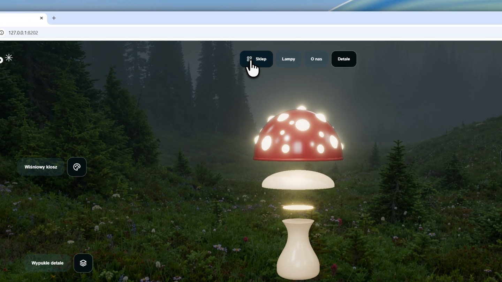

# Mimo 

An atmospheric product website for a mushroom-shaped lamp. Built as a frontend portfolio project to explore product presentation, motion and visual storytelling.

[](https://github.com/Kredickoa/mimo-2/raw/refs/heads/main/demo/demo.mp4)

[Watch the demo video](https://github.com/Kredickoa/mimo-2/raw/refs/heads/main/demo/demo.mp4)

## Highlights

- A real-time 3D lamp with a scroll-controlled exploded view.
- Forest scenery, interactive lighting and smooth section navigation.

## Stack

JavaScript, Vite, Three.js, WebGL and CSS.

## Run locally

Requires Node.js 22.12+ and npm.

```bash
npm ci
npm run dev
```

Create a production build with `npm run build`, then run `npm run preview` to preview it.

The build also exports the lamp model as a GLB file.

Concept project, not a live commercial service. Any enquiry, cart or booking controls are demonstrations.

## Rights

All rights reserved. Shared for portfolio review; reuse requires prior written permission. See [LICENSE](LICENSE). Third-party materials retain their own licenses.
